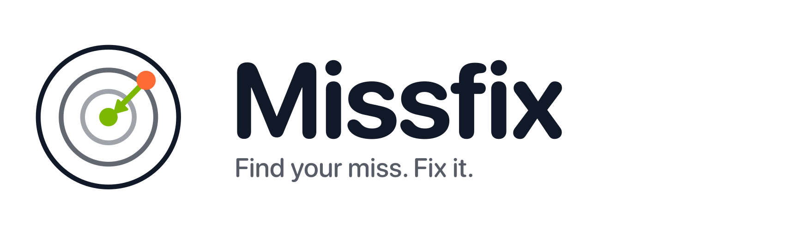
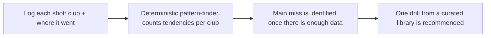

<div align="center">
  <picture>
    <source media="(prefers-color-scheme: dark)" srcset="branding/missfix-wordmark-on-dark.png">
    
  </picture>

  <p><strong>Find your miss. Fix it.</strong></p>

     
</div>

> **Status: in design.** Missfix is a fully briefed and branded product concept. The plan, scope and open questions are documented; the app has not been built yet.

## The idea

A practice-session companion for the driving range: log your shots, find the pattern in your misses, and get one drill to work on.

- **For:** Golfers who hit balls at the range without a clear idea of what to fix.
- **Outcome:** Leave the range knowing your main miss and the one drill to work on next.

## How it will work



## Planned features

- Fast, manual shot logging built for the range
- Inspectable pattern-finding (counts and tendencies, not a black box)
- Small curated drill library in plain language
- Says "not enough data" until a pattern is real
- All data on-device, no account

## Tech plan

| Layer | Choice |
|---|---|
| Language / UI | Swift, SwiftUI (iOS 17+) |
| Analysis | Deterministic, on-device |
| Storage | Local |
| Backend | None |

## Privacy by design

All practice data stays on the device. No account.

## Open decisions

Tracked openly in [`docs/PROJECT_BRIEF.md`](docs/PROJECT_BRIEF.md). A few of the big ones:

- How are shots logged: tap-per-shot with a miss-direction picker, voice, or both? What is the minimum data per shot?
- How many shots are needed before a pattern is shown? Below that, the app should say there is not enough data.
- Who writes and approves the drill library, and how are drills matched to a pattern?
- Is launch-monitor or Apple Watch input wanted in v1? (Not assumed.)

## Brand

| | Name | Hex | Role |
|---|---|---|---|
|  | Night | `#111827` | Icon field, text, dark surfaces |
|  | White | `#FFFFFF` | Target rings, light surfaces |
|  | Fix Lime | `#C6F432` | Bullseye, correction arrow, key actions |
|  | Miss Orange | `#FF6B35` | The miss, warnings |

**Mark.** A target with an orange miss off to one side and a lime arrow pulling it back to the bullseye: the miss, found and fixed.

**Voice.** Coach-like, specific and encouraging. Name the pattern in plain words ("your 7-iron misses right"), give one thing to work on, never a lecture.

Full logo set (mark, wordmark, app icon in light and dark) and the brand guide are in [`branding/`](branding/BRAND_GUIDE.md).

## Repository contents

```
docs/PROJECT_BRIEF.md   Confirmed requirements, assumptions, open questions, scope
branding/               Logo files and BRAND_GUIDE.md
```

## License

Proprietary. Shared publicly for portfolio and demonstration purposes only. See [LICENSE](LICENSE).

---

<div align="center">

Built by [Aquila Digital LLC](https://github.com/Steven6Brown) · *Per Aspera Ad Astra*

</div>
